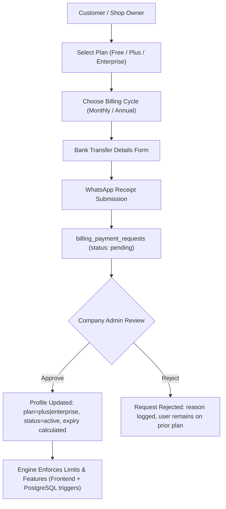
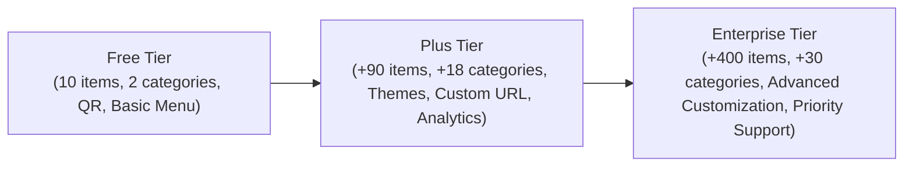

# Menuzo Subscription System Documentation

**Version:** 2.0.0  
**Last Updated:** 2026-11-18  
**Scope:** Architecture, Plan Tiers, Limits, Feature Entitlements, and Services Reference

---

## 1. System Overview

Menuzo uses a centralized, tiered subscription model structured across three primary tiers:
1. **Free (Starter):** For micro-restaurants, food stalls, and cafes getting started.
2. **Plus (Recommended - Formerly Pro):** For established restaurants needing larger capacity, custom branding, personalized short URLs, and analytics.
3. **Enterprise (Advanced):** For high-volume multi-category menus, fine dining, or hospitality businesses requiring expanded catalog capacity, advanced customization, priority support, and all premium features.

The subscription model operates on **manual bank transfers with WhatsApp proof verification**, featuring approval workflows managed by company administrators.

---

## 2. Plan Definitions & Pricing

| Attribute | Free | Plus (Previously Pro) | Enterprise |
| :--- | :--- | :--- | :--- |
| **Slug** | `free` | `plus` (alias: `pro`) | `enterprise` |
| **Display Name** | Free | Plus | Enterprise |
| **Monthly Price** | LKR 0 | LKR 1,500 / month | LKR 6,000 / month |
| **Annual Regular** | LKR 0 | LKR 18,000 | LKR 72,000 |
| **Annual Price** | LKR 0 | LKR 15,000 / year | LKR 65,000 / year |
| **Annual Savings** | LKR 0 | LKR 3,000 (16.7% off) | LKR 7,000 (9.7% off) |
| **Effective Monthly**| LKR 0 | LKR 1,250 / month | LKR 5,416.67 / month |
| **Max Food Items** | 10 | 100 | 500 |
| **Max Categories** | 2 | 20 | 50 |

---

## 3. Plan Feature Entitlements & Inheritance

Menuzo applies the **Enterprise Access Principle**:
$$\text{Enterprise} = \text{Plus Features} + \text{Enterprise Extensions}$$

### Feature Entitlement Matrix

| Feature Key | Free | Plus | Enterprise | Description |
| :--- | :---: | :---: | :---: | :--- |
| `digitalMenu` | Yes | Yes | Yes | Mobile-responsive public digital menu |
| `qrCodeGeneration` | Yes | Yes | Yes | Dynamic QR code generation for tables and counters |
| `customThemes` | Preset (5) | Full | Full | Custom colors and curated theme library |
| `qrBranding` | Basic | Advanced | Advanced | Custom QR colors, logos, and frame customization |
| `customUrl` | No | Yes | Yes | Vanity slug `/restaurant-name` |
| `analytics` | Basic | Advanced | Advanced | Views, scans, trends, and daily performance metrics |
| `portionVariants` | Yes | Yes | Yes | Multi-portion pricing (Regular, Large, etc.) |
| `menuCustomization`| Basic | Standard | Advanced | Layout presets and fine-grained visual control |
| `advancedCustomization`| No | No | Yes | Full brand controls, custom typography and styles |
| `prioritySupport` | No | No | Yes | Dedicated priority response channel |
| `allAvailableFeatures`| No | No | Yes | Automatic entitlement to upcoming feature releases |

---

## 4. Centralized Subscription Engine (`src/lib/subscription.ts`)

The subscription engine provides typed configuration constants and utility functions:

### Constants
- `PLAN_LIMITS`: Canonical dictionary specifying item and category limits for `free`, `plus`, and `enterprise`.
- `PLAN_FEATURES`: Entitlement definitions for each plan slug.
- `PLAN_PRICING`: Canonical prices, regular annual costs, and annual savings in LKR.
- `PLAN_DESCRIPTIONS`: Short marketing blurbs and taglines.
- `PRO_GRACE_DAYS`: 3 days grace period upon expiration.
- `PRO_ENDING_SOON_DAYS`: 7 days prior to expiry notice.

### Core Helper Functions
- `isPaidActive(subscription, now?)`: Returns `true` if plan is `'plus'`, `'pro'`, or `'enterprise'`, `status === 'active'`, and `expiresAt > now`.
- `isProActive(subscription, now?)`: Backward-compatible alias for `isPaidActive`.
- `getPlanLimits(subscription, now?)`: Resolves item and category limits dynamically based on plan status and grace period. If expired outside grace, falls back to `FREE_PLAN_LIMITS`.
- `hasFeatureAccess(subscription, featureKey, now?)`: Checks boolean or tier-based entitlement for a given feature key.
- `canCreateItem(subscription, currentCount, now?)`: Returns `{ allowed: boolean, max: number, current: number, plan: string }`.
- `canCreateCategory(subscription, currentCount, now?)`: Returns `{ allowed: boolean, max: number, current: number, plan: string }`.
- `calculateSubscriptionExpiry(currentExpiry, periodMonths, fromDate?)`: Computes renewal extension. Extends existing unexpired time or starts from today if expired or new.

---

## 5. Subscription Service (`src/services/subscription.service.ts`)

Centralized service interfacing with Supabase and local subscription state:
- `getSubscription(userId)`: Hydrates user subscription from PostgreSQL `profiles` table.
- `getPlans()`: Returns cached or Supabase-backed subscription plan objects (`SubscriptionPlan[]`).
- `getPlan(slug)`: Retrieves a specific plan definition.
- `getPlanLimits(planSlug)`: Directly fetches configured limits for a tier.
- `hasFeatureAccess(planSlug, featureKey)`: Evaluates plan entitlements.
- `canCreateItem(planSlug, currentCount)`: Validates creation allowance against limits.
- `canCreateCategory(planSlug, currentCount)`: Validates category creation allowance.
- `canUpgradePlan(currentSlug, targetSlug)`: Validates whether target plan is an upgrade.
- `canDowngradePlan(currentSlug, targetSlug)`: Validates whether target plan is a downgrade.

---

## 6. Backward Compatibility Guarantees

1. **`pro` Slug Support:**
   - Any historical profile with `subscription_plan = 'pro'` is automatically normalized and treated identically to `plus`.
   - Admin RPCs and database functions accept both `'plus'` and `'pro'`.
2. **`isProActive` Export:**
   - Retained as a direct alias for `isPaidActive` across legacy components.
3. **`PRO_PLAN_LIMITS` Export:**
   - Retained as an alias for `PLUS_PLAN_LIMITS`.
4. **Permanent Custom URLs:**
   - Custom URLs previously assigned remain valid even if the subscription lapses, redirecting traffic to the canonical menu.
